<div align="center">

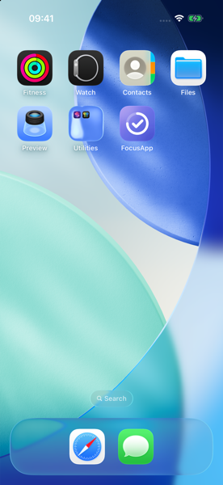

# Progress Tracker

**Une app de productivité iOS en SwiftUI : tâches, sessions de focus Pomodoro, calendrier et statistiques.**


</div>

> **Projet d'apprentissage.** Il a été écrit pour apprendre **Swift et SwiftUI** quand on vient de React / React Native. Chaque concept est expliqué dans le code par un commentaire `// ⚛️ React :` qui le compare à son équivalent côté React. Les écrans reproduisent fidèlement un design de référence.

<p align="center">
  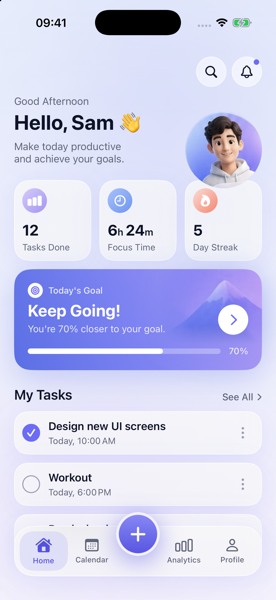
  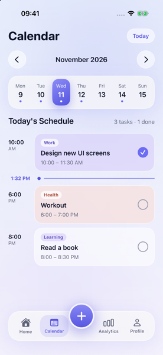
  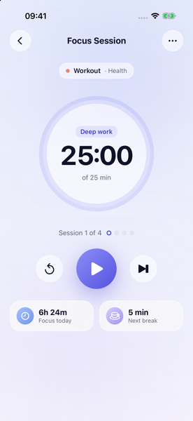
  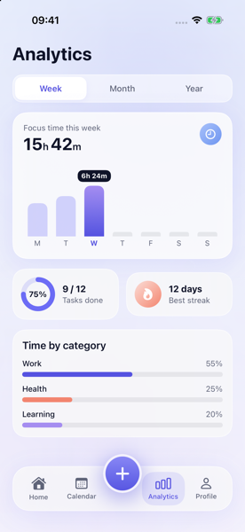
  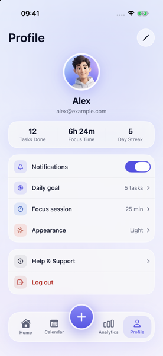
</p>

## Fonctionnalités

| | |
|---|---|
| ✅ **Tâches** | Créer, modifier, supprimer, cocher ; catégorie, priorité, durée, rappel |
| ⏱️ **Sessions de focus** | Minuteur Pomodoro (focus, pause, pause longue) avec anneau de progression |
| 📅 **Calendrier** | Bandeau de la semaine, planning du jour, repère « maintenant » |
| 📊 **Analytics** | Temps de focus par semaine, mois ou année (Swift Charts), répartition par catégorie, meilleure série |
| 🔔 **Notifications** | Générées par de vrais événements : tâche terminée, objectif du jour, session de focus, série |
| 🔍 **Recherche** | Recherche dans les tâches, avec ouverture du jour concerné dans le calendrier |
| 👤 **Profil** | Modification du nom, de l'e-mail et de la photo ; réglages persistés |
| 🌗 **Apparence** | Clair, sombre ou système |
| 👋 **Parcours d'entrée** | Splash, onboarding en 3 pages, inscription et connexion (fictives, sans serveur) |

Les données restent **sur l'appareil** (SwiftData). Au premier lancement l'app est vide, avec des états vides soignés ; les statistiques (tâches faites, temps de focus, série, objectif) sont **calculées** à partir des tâches et des sessions, jamais stockées.

<details>
<summary><b>Plus de captures</b> (parcours d'entrée, recherche, mode sombre)</summary>

<p align="center">
  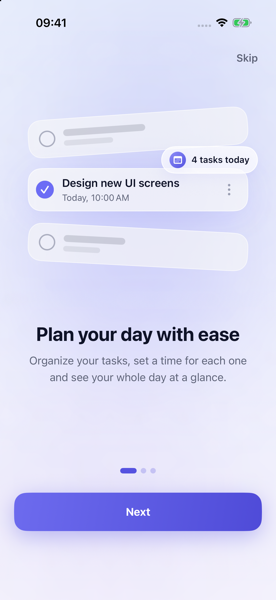
  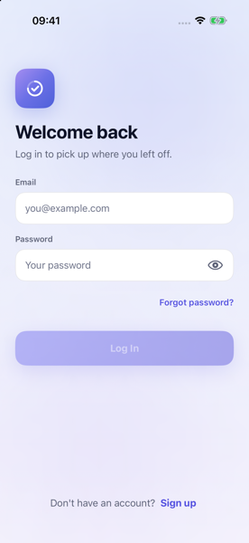
  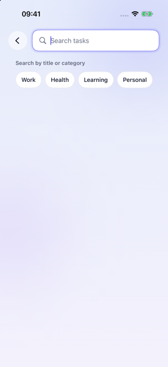
  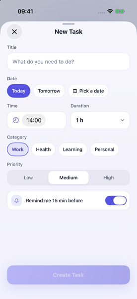
  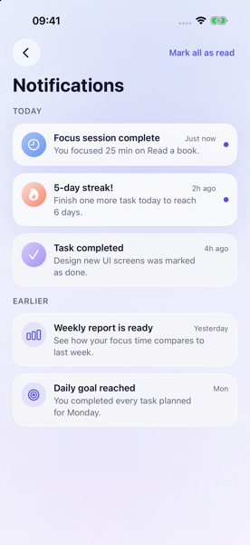
</p>
<p align="center">
  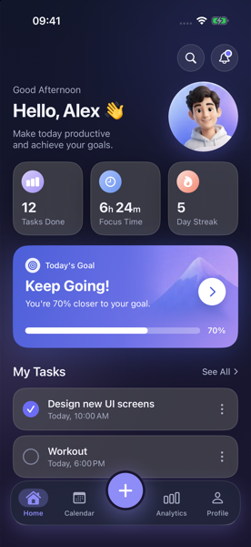
  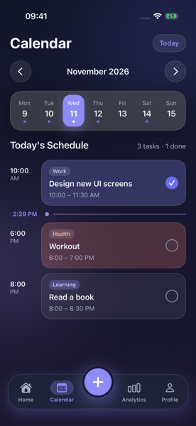
  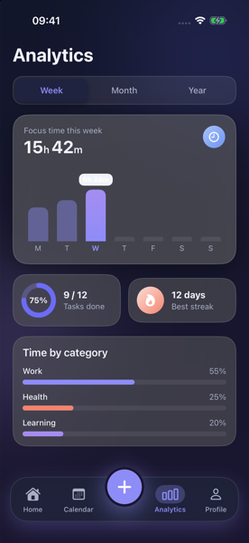
  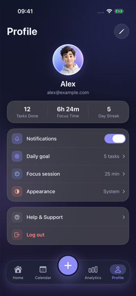
  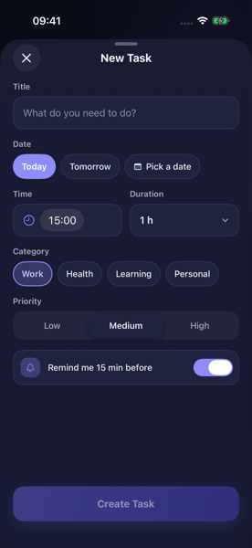
</p>

</details>

## Stack

- **SwiftUI** (iOS 17+) et **Observation** (`@Observable`) : interface et état
- **SwiftData** : stockage local des tâches, de l'historique de focus et des notifications
- **Swift Charts** : graphiques d'Analytics
- **Swift Testing** : 140 tests dans 23 suites
- **XcodeGen** : le projet Xcode est généré depuis `project.yml`
- **Aucune dépendance tierce** : ni SPM, ni CocoaPods, ni Carthage

## Démarrer

**Prérequis :** macOS, Xcode 16 ou plus récent, [Homebrew](https://brew.sh).

```bash
brew install xcodegen xcbeautify     # xcbeautify est optionnel (logs lisibles)
git clone <url-du-repo> && cd FocusApp      # le dossier garde son nom technique
xcodegen generate                    # génère FocusApp.xcodeproj
open FocusApp.xcodeproj              # puis ⌘R dans Xcode
```

En ligne de commande :

```bash
# Compiler et lancer les tests
xcodebuild -project FocusApp.xcodeproj -scheme FocusApp \
  -destination "platform=iOS Simulator,name=iPhone 17 Pro" \
  -derivedDataPath build test | xcbeautify
```

> Le dossier `FocusApp.xcodeproj` est un artefact généré : après avoir ajouté, supprimé ou déplacé un fichier, relancer `xcodegen generate`. Les commandes de capture d'écran et de vérification visuelle sont dans [`SETUP.md`](SETUP.md).

## Architecture

**MVVM** : les vues sont de simples fonctions de l'état, les ViewModels `@Observable` portent la logique, les services isolent le stockage.

```
FocusApp/
├── App/            Point d'entrée, RootView (onglets + navigation), routes
├── DesignSystem/   Tokens : couleurs (clair/sombre), typographie, espacements, rayons
├── Models/         Types métier (TaskItem, FocusSession…) et calculs (LocalStats)
├── Services/       DataStore (protocole) → SwiftDataStore (prod) / InMemoryStore (tests)
├── ViewModels/     Home, Calendar, Analytics, Notifications, FocusSession, Auth
├── Views/          Un dossier par écran ; composants présentationnels dans Components/
├── Mock/           Données d'exemple : previews et tests uniquement
└── Utilities/      Extensions de dates et de calendrier
```

```
Vue  ──intention──▶  ViewModel  ──lit / écrit──▶  DataStore (SwiftData)
 ▲                       │
 └──────état observé─────┘     statistiques = LocalStats(tâches, sessions)
```

Règles du projet : aucune couleur, taille de police ni espacement en dur dans les vues (tout passe par `DesignSystem/`), une vue par fichier avec son `#Preview`, des icônes SF Symbols, un `.accessibilityLabel` sur chaque bouton icône.

## Documentation

| Fichier | Contenu |
|---|---|
| [`docs/ARCHITECTURE.md`](docs/ARCHITECTURE.md) | Arborescence, modèles, flux de données |
| [`docs/DESIGN_SYSTEM.md`](docs/DESIGN_SYSTEM.md) | Couleurs (clair et sombre), typographie, espacements, icônes |
| [`docs/DECISIONS.md`](docs/DECISIONS.md) | Les décisions techniques et leurs raisons (D-001 à D-048) |
| [`docs/CONCEPTS.md`](docs/CONCEPTS.md) | Glossaire Swift ↔ React des concepts rencontrés |
| [`docs/ROADMAP.md`](docs/ROADMAP.md) | Les 22 étapes du projet, toutes terminées |
| [`SETUP.md`](SETUP.md) | Outillage, commandes de build, de test et de capture |

## Limites connues

- L'authentification est **fictive** : la session est gardée dans `UserDefaults`, rien n'est envoyé nulle part.
- Les actions « Help & Support », « Forgot password » et le menu ⋯ de la session de focus sont des maquettes sans effet.
- La palette sombre est dérivée de la palette claire (le design n'a pas de version sombre).
- L'écran de lancement est dimensionné pour un iPhone 17 Pro ; la vue Year d'Analytics peut chevaucher son infobulle (voir `docs/DECISIONS.md`).
